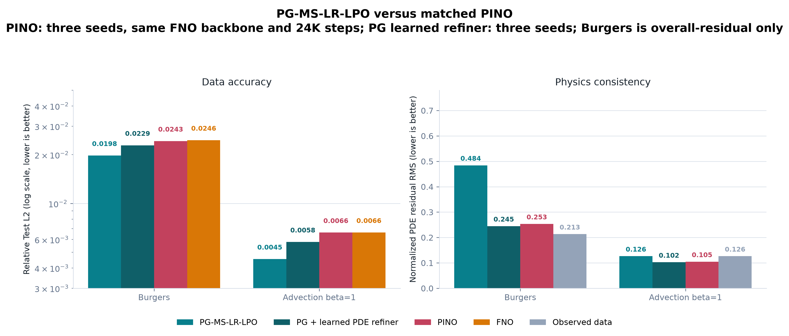

# 物理引导多尺度低秩潜空间 PDE 神经算子

**Physics-Guided Multi-Scale Low-Rank Latent PDE Operator (PG-MS-LR-LPO)**

当前标准模型是在原 MS-LR-LPO 上加入可选周期常速平移分支和导数感知物理残差
修正分支的物理引导神经算子。
主线流程为：

完整方法、实验协议、结果边界与复现说明见
[技术报告](docs/TECHNICAL_REPORT.md)。

PDF 版本见
[PG-MS-LR-LPO 技术报告（PDF）](output/pdf/PG-MS-LR-LPO-Technical-Report.pdf)。

独立残差、配对统计、外部泛化与物理公式审计见
[实验审计与补充结果](docs/EXPERIMENT_AUDIT_20261127.md)。

冻结配置、数据获取和统计协议见
[复现实验协议](docs/REPRODUCIBILITY.md)。

正式论文骨架见 [LaTeX manuscript](paper/main.tex)。

多维 PDE 扩展、官方数据转换和训练命令见
[多维 PDE 求解扩展](docs/MULTIDIMENSIONAL_PDE.md)。

首个 PDEBench 2D diffusion-reaction 三 seed 结果为 PG-Lite `0.1053 ± 0.0006`、
参数匹配 FNO `0.2840 ± 0.0001`、DeepONet `0.7986 ± 0.0036`
（`t=10` 状态到未来轨迹，64×64×41）。

在 PDEBench 2D incompressible NS 上，PG-Lite 速度 `0.1742 ± 0.0035`、散度
`0.0366 ± 0.0020`；FNO 分别为 `0.3167 ± 0.0273` 和 `0.0994 ± 0.0196`。

一维 advection 在 ±20% 参数先验、8 个时间快照和 0–10% 噪声下，β 反演
100% 落在 5% 误差内，MAPE 为 `0.036%–0.049%`。

PDEBench 官方 advection 的八个 β 已全部补齐。低 β 的解析平移分支保持领先，
高 β 的失败边界仍然从 β=2 开始出现。

β=2、4、7 的最终残差阶段已完成三 seed 稳定性检查。β=2、4 仍优于参数匹配 FNO；
β=7 三 seed 均值为 `0.011357 ± 0.000008`，仍落后 FNO 的 `0.009003`。

PINO 对比已完成。Burgers 基础 PG 数据误差为 `0.019767`，PINO 为 `0.024261`；
advection β=1 上 PG `0.004543`，PINO `0.006619`。基础 PG 的残差仍落后 PINO。

Burgers 新增导数感知修正器后，三 seed 数据误差为
`0.022853 ± 0.000123`、PDE 残差为 `0.244626 ± 0.001483`。两项分别比匹配 PINO
的 `0.024261 / 0.253304` 低约 `5.8% / 3.4%`。独立审计显示该 residual 优势主要
来自时间边界，interior 和四阶 residual 仍落后 PINO，因此只能声明总体指标领先。
总参数 `502,989`，比 PINO 少 8 个。

Advection β=1 新增解析平移后的输出端物理修正器，三 seed 数据误差为
`0.005789 ± 0.000110`、PDE 残差为 `0.102403 ± 0.000327`。两项分别比 PINO
的 `0.006619 / 0.104517` 低约 `12.5% / 2.0%`，Welch 检验为
`p=0.00098 / 0.00304`。总参数 `501,668`，比 PINO 少 1,497 个。
Seed-7 的 1000 样本配对 bootstrap 与 Holm 校正也支持四个总体指标差异。

历史修正器仍保留用于消融：3×3 精度优先版本训练 305 个参数，数据误差
`0.018761 ± 0.000038`、残差 `0.3718`；11×11 两阶段版本训练 4,375 个参数，
残差 `0.284789 ± 0.002106`。导数分支在此基础上只增加 59 个参数，把残差降到
`0.244626`，同时仍保持对 PINO 的数据优势。

三个一维任务的 4096 查询点高监督 DeepONet 三 seed 已完成。Burgers
`0.2532 ± 0.0050`、advection β=1 `0.4964 ± 0.0136`、diffusion-sorption
`0.0157 ± 0.0036`，仍全部落后对应 PG。1D 推理延迟 PG `22.0 ms`、FNO
`1.20 ms`、DeepONet `6.07 ms`（batch=32）。

```text
u0(x) -> context encoder
      -> LatentPDE time evolution
      -> multi-scale skips
      -> low-rank grid decoder
      -> physics-guided transport fusion
      -> optional learned PDE refiner (pre/post transport)
      -> u(x, t)
```

## 核心图




## 标准模型

神经算子输出记为 `u_n`。当任务已知周期常速平流系数 `beta` 时，模型额外构造：

```text
u_p(x, t) = u0((x - beta * t) mod 1)

u(x, t) = u_p(x, t)
          + alpha * (u_n(x, t) - u_p(x, t))
```

低 beta 的 advection 基准使用固定 `alpha = 0`。高速平移时可以把 `alpha` 设为可学习参数，
让神经分支拟合平移基线的离散残差。固定分支不增加参数，可学习分支只增加 1 个参数。
Burgers 和 diffusion-sorption 没有已知常速平移项，因此关闭该分支，模型退化为原 MS-LR-LPO。

这个分支是物理先验，不是对所有 PDE 都生效的通用加速器。Burgers 的输运速度依赖局部解 `u`，
不能直接复用常数 `beta`。

## 主要结果

所有结果使用 PDEBench 官方数据，采用相同划分：

- train: `8000`
- dev: `1000`
- test: `1000`
- 下表为 seed 7，评价指标为 full-grid relative Test L2

| 数据集 | 原 MS-LR-LPO | PG-MS-LR-LPO | FNO | DeepONet |
|---|---:|---:|---:|---:|
| Burgers `Nu=0.01` | 0.019759 | **0.019758** | 0.024355 | 0.250013 |
| 1D diffusion-sorption | 0.003312 | **0.003310** | 0.701195 | 0.012846 |
| 1D advection `beta=1.0` | 0.017053 | **0.004543** | 0.006542 | 0.492854 |

物理引导模型相对两个参数匹配 baseline：

| 数据集 | 比 FNO 低 | 比 DeepONet 低 |
|---|---:|---:|
| Burgers | 19.61% | 92.19% |
| Diffusion-sorption | 99.52% | 78.57% |
| Advection | 31.44% | 99.08% |

主表的 Burgers、advection β=1 和 diffusion-sorption 使用每步 `4096` 个查询点的
高监督 DeepONet。其余 advection β 仍使用标准 `256` 查询点，并在对应章节注明。

下面的百分比汇总和性能图使用三 seed 均值；主表保留 seed 7 原始值，便于逐项核对。

### 结果边界与可声明范围

当前可支持的结论是：

- 在 Burgers `Nu=0.01`、diffusion-sorption 和官方八个 advection β 上，
  PG-MS-LR-LPO 在绝大多数设置中优于参数匹配 FNO。
- 在所有已测设置中，PG-MS-LR-LPO 均优于参数匹配 DeepONet，包括已完成
  4096 查询点高监督版本的三个一维任务。
- β=2、4 的可学习残差可以超过 FNO；β=7 的高频分支三 seed 最终阶段均值为
  `0.011357 ± 0.000008`，仍落后 FNO 的 `0.009003`，是当前明确失败案例。
- β=2、4、7 的三 seed 只改变最终残差微调阶段，三个 seed 共享早期 checkpoint；
  该结果证明最终阶段稳定，不等同于三次从零独立训练。
- Burgers 的导数感知修正器在三 seed 上同时赢得数据 L2 和归一化 PDE 残差；
  基础 PG 和历史修正器仍保留为对照。
- Advection β=1 的输出端物理修正器也在三 seed 上同时低于 PINO 的数据 L2 和
  归一化 PDE residual；基础解析平移仍保留为不增加参数的对照。

尚不能声称“全面超过官方 PDEBench”：

- Burgers 只使用 `Nu=0.01`，不是全部 12 个粘度文件。
- Advection 已覆盖官方 `0.1, 0.2, 0.4, 0.7, 1.0, 2.0, 4.0, 7.0`。
- 1D CFD、2D CFD、Darcy 和 SWE 尚未执行；NS 只覆盖二维力条件速度场子集，
  尚无完整压力场和全分辨率结果。
- FNO/DeepONet 是项目内的参数匹配实现，不是 PDEBench 官方榜单结果。
- 其余 advection β 的 DeepONet 仍使用 256 点随机监督；三个主要一维任务已完成
  4096 点高监督版本。

## Advection 改进

Advection 原模型 Test L2 为 `0.017053`。单纯从 12K checkpoint 继续训练 6K 后降至
`0.015620`，仍落后 FNO。启用周期平移分支后：

```text
Test L2 = 0.004543
```

相比原模型降低约 `73.4%`。参数匹配后的 FNO 配置为 `modes=25, width=68`
（503,165 参数），三 seed Test L2 为 `0.006626 +- 0.000109`；PG-MS-LR-LPO
输出不依赖随机初始化，仍比它低约 `31.4%`。

平移速度只在 dev 的 `0.98..1.02` 范围内搜索，dev 最优值为 `1.0`，没有使用 test 调参。
线性插值在 dev 上优于 Fourier shift 和三次插值，因此作为标准实现。

### Advection 三 seed

| 方法 | Seed 7 | Seed 11 | Seed 23 | Mean +- Std |
|---|---:|---:|---:|---:|
| PG-MS-LR-LPO | 0.004543 | 0.004543 | 0.004543 | **0.004543 +- 0** |
| 参数匹配 FNO | 0.006542 | 0.006749 | 0.006586 | 0.006626 +- 0.000109 |
| 参数匹配 DeepONet，256 点 | 0.440765 | 0.501917 | 0.548459 | 0.497047 +- 0.054012 |
| 参数匹配 DeepONet，4096 点 | 0.492854 | 0.511424 | 0.484865 | **0.496381 +- 0.013627** |

PG 对 FNO 的 Welch p 为 `0.00091`，对 DeepONet 为 `0.00399`。

### 高速平移与残差融合

`beta=2.0` 时，线性平移的离散误差明显增大。固定平移 Test L2 为 `0.008304`，
反而落后 FNO 的 `0.006300`。将融合系数设为可学习，并从固定平移解继续训练 4K 步后：

本段保留 seed 7 的优化轨迹；下面的八参数汇总改用 FNO/DeepONet 三 seed 均值，
因此 β=2 的 FNO 数值为 `0.006389`。

| beta=2.0 方法 | 参数 | Test L2 |
|---|---:|---:|
| 基础神经模型 | 501,435 | 0.020495 |
| 固定周期平移 | 501,435 | 0.008304 |
| PG + 可学习残差融合（36K） | 501,436 | **0.005043** |
| 参数匹配 FNO | 503,165 | 0.006300 |
| DeepONet | 501,473 | 0.6260 |

学习得到的融合系数为 `0.0423`。残差训练里程碑：

| 残差步数 | 8K | 12K | 18K | 24K | 28K | 32K | 36K |
|---|---:|---:|---:|---:|---:|---:|---:|
| Test L2 | 0.005639 | 0.005503 | 0.005305 | 0.005181 | 0.005127 | 0.005080 | **0.005043** |

32K 后单 1K 收益已低于约 `0.1%`，36K 仍无 dev/test 过拟合迹象，但进入低收益平台。
这说明高速平流不能只依赖解析平移，必须学习插值残差。

### 参数网格与反演可辨识性

当前 advection 参数网格已扩展到：

```text
beta = 0.1, 0.2, 0.4, 0.7, 1.0, 2.0, 4.0, 7.0
```

八参数 Test L2（FNO/DeepONet 为三 seed 均值；可学习残差为最终阶段三 seed）：

| beta | 固定平移 PG | 可学习残差 PG | FNO | DeepONet |
|---:|---:|---:|---:|---:|
| 0.1 | **0.001154** | - | 0.003802 | 0.115324 |
| 0.2 | **0.001645** | - | 0.005010 | 0.132452 |
| 0.4 | **0.002547** | - | 0.006037 | 0.243269 |
| 0.7 | **0.003762** | - | 0.006435 | 0.326126 |
| 1.0 | **0.004543** | - | 0.006626 | 0.496381 |
| 2.0 | 0.008304 | **0.005043 ± 0.000002** | 0.006389 | 0.623089 |
| 4.0 | 0.017987 | **0.007183 ± 0.000001** | 0.007262 | 0.701016 |
| 7.0 | 0.033748 | 0.011357 ± 0.000008 | **0.009003** | 0.706937 |

DeepONet 在 β=1 行使用 4096 点高监督，其余 advection 参数使用 256 点标准配置。

β≤1 时解析平移已经很强；β≥2 后离散插值误差快速增大，必须依靠可学习残差。
β=2 和 β=4 的独立残差模型已经重新超过 FNO。β=7 的最强变体使用 128 点解码网格、
30 个 Fourier bands、17 个 rollout anchors 和 hidden-20 局部残差滤波器，从
`0.014044` 改善到 `0.011357 ± 0.000008`，提升约 19%，但仍落后 FNO。最终参数为 `503,161`，
比 FNO 少 4 个。256 点网格在约 500 步时需要 10 分钟，暂不采用。

### 残差分支最终阶段三 seed

三个 seed 使用相同入口 checkpoint，仅最终残差阶段分别使用 seed 7、11、23：

| beta | Seed 7 | Seed 11 | Seed 23 | Mean +- Std | FNO |
|---:|---:|---:|---:|---:|---:|
| 2.0 | 0.00504318 | 0.00504162 | 0.00504465 | **0.00504315 +- 0.00000152** | 0.006389 |
| 4.0 | 0.00718284 | 0.00718236 | 0.00718401 | **0.00718307 +- 0.00000085** | 0.007262 |
| 7.0 | 0.01135244 | 0.01135171 | 0.01136538 | 0.01135651 +- 0.00000769 | 0.009003 |

β=2 和 β=4 的优势在 seed 间稳定存在；β=7 的失败也没有被 seed 选择掩盖。

对多参数轨迹做无先验 β 扫描时发现：周期离散平移存在速度混叠。在时间步长
`dt=0.02`、空间网格 `NX=256` 时，相隔 `1/(dt*NX)=0.1953` 的候选速度会产生近似
整数格点平移。因此“无范围约束的全局参数反演”是不适定的。

这不代表反演不可做，而是论文必须加入：

- β 的物理先验范围；
- 非均匀时间观测；
- 多初值或多视图数据；
- 或直接学习参数后验分布。

当前反演实验用于诊断可辨识性，不作为最终成功率结果。

## Burgers 三 seed

关闭平移分支后，PG-MS-LR-LPO 与 Burgers 原模型等价。三 seed Test L2：

| 方法 | Seed 7 | Seed 11 | Seed 23 | Mean +- Std |
|---|---:|---:|---:|---:|
| PG-MS-LR-LPO，平移分支关闭 | 0.019759 | 0.019775 | 0.019767 | **0.019767 +- 0.000008** |
| 参数匹配 FNO | 0.024355 | 0.024388 | 0.025020 | 0.024588 +- 0.000375 |
| 参数匹配 DeepONet，256 点 | 0.267974 | 0.261488 | 0.268660 | 0.266041 +- 0.003958 |
| 参数匹配 DeepONet，4096 点 | 0.250013 | 0.250473 | 0.258966 | **0.253151 +- 0.005041** |

与 FNO 的三 seed Welch t 检验为 `p = 0.0020`。

## Diffusion-sorption 三 seed

| 方法 | Seed 7 | Seed 11 | Seed 23 | Mean +- Std |
|---|---:|---:|---:|---:|
| PG-MS-LR-LPO | 0.003312 | 0.003326 | 0.003472 | **0.003370 +- 0.000089** |
| 最佳参数匹配 FNO | 0.701195 | 0.701195 | 0.701195 | 0.701195 +- 0.000000 |
| 参数匹配 DeepONet，256 点 | 0.014917 | 0.020987 | 0.017468 | 0.017791 +- 0.003048 |
| 参数匹配 DeepONet，4096 点 | 0.012846 | 0.019714 | 0.014616 | **0.015725 +- 0.003566** |

PG 对 FNO 的 Welch p 为 `5.37e-9`，对高监督 DeepONet 为 `0.0266`。

## 参数口径

| 模型 | 参数量 | 说明 |
|---|---:|---|
| PG-MS-LR-LPO | 501,435 | rank17 低秩解码器，标准参数口径 |
| PG + 可学习残差融合 | 501,436 | 高速平移变体，仅增加 1 个融合参数 |
| PG + 128 网格 + x_bands 32 | 502,972 | β=7 高频变体，接近 FNO 参数预算 |
| PG + 高频残差滤波器 | 503,161 | β=7 最终变体，比 FNO 少 4 个参数 |
| Burgers 原 checkpoint | 498,555 | rank16，三 seed 精度实测来源 |
| 参数匹配 FNO | 502,997-503,165 | Burgers 使用 width 104, modes 10；跨 PDE 使用 width 68, modes 25 |
| 参数匹配 DeepONet | 501,473 | basis 128, branch 512, trunk 148 |
| 参数匹配 PINO | 502,997-503,165 | 与 FNO 相同主干，增加归一化 PDE residual loss |
| PG + 3×3 轻量修正器 | 498,860 | Burgers 精度优先；新增 305 个可训练参数 |
| PG + 5×5 残差修正器 | 499,780 | Burgers 残差优先；新增 1,225 个可训练参数 |
| PG + 9×9 两阶段修正器 | 502,468 | Burgers 前代残差版本；新增 3,913 个可训练参数 |
| PG + 11×11 两阶段修正器 | 502,930 | Burgers 历史残差版本；新增 4,375 个可训练参数 |
| PG + 导数感知修正器 | 502,989 | Burgers 双指标标准；新增 4,434 个可训练参数，比 PINO 少 8 个 |
| PG + advection 输出修正器 | 501,668 | β=1 双指标标准；新增 233 个可训练参数 |

固定平移分支不使用可训练参数；可学习残差融合只增加 1 个标量。Burgers 表中新模型使用
rank16 checkpoint，向 rank17 的零扩展不会改变前向函数，因此与 `501,435` 输出严格一致。
Advection 输出修正器位于解析平移之后，零初始化时保持原固定平移函数不变。

## PINO 对比

PINO 使用与 FNO 完全相同的参数匹配主干、数据划分、24K 训练步和 batch size，
额外加入归一化 PDE residual loss。权重先在 8K 步、seed 7 上选择：

- Burgers 选择 `lambda_phys=1e-4`，因为 dev 数据误差最低。
- Advection β=1 选择 `lambda_phys=5e-4`，因为 dev 数据误差相同且残差更低。

| 模型，Burgers | Test L2 | PDE residual | 参数量 |
|---|---:|---:|---:|
| PG 基础版 | 0.019767 ± 0.000009 | 0.4843 | 498,555 |
| PG + 3×3 | **0.018761 ± 0.000038** | 0.3718 | 498,860 |
| PG + 5×5 | 0.019342 ± 0.000159 | 0.3511 | 499,780 |
| PG + 9×9，两阶段 | 0.019457 ± 0.000074 | 0.289839 ± 0.001795 | 502,468 |
| PG + 11×11，两阶段 | 0.019554 ± 0.000084 | 0.284789 ± 0.002106 | 502,930 |
| PG + 导数感知，双指标标准 | **0.022853 ± 0.000123** | **0.244626 ± 0.001483** | 502,989 |
| PINO | 0.024261 ± 0.000393 | **0.253304** | 502,997 |
| 观测离散底噪 | - | 0.213228 | - |

基础 PG 对 PINO 的 Welch 检验为 `p=0.0025`；3×3、5×5、9×9、11×11 修正器
对 PINO 分别为 `p=0.00156`、`p=0.00058`、`p=0.00164`、`p=0.00157`。候选和明细见
[pg_physics_refiner_summary.json](analysis_plots_clean/pg_physics_refiner_summary.json)。
导数感知修正器的 L2 与残差 Welch 检验分别为 `p=0.0177` 和 `p=0.0259`。

| 模型，Advection β=1 | Test L2 | PDE residual | 参数量 |
|---|---:|---:|---:|
| PG 固定周期平移 | **0.004543 ± 0** | 0.126372 | 501,435 |
| PG + 输出端物理修正器，双指标标准 | 0.005789 ± 0.000110 | **0.102403 ± 0.000327** | 501,668 |
| PINO | 0.006619 ± 0.000068 | 0.104517 ± 0.000139 | 503,165 |
| 观测离散底噪 | - | 0.126372 | - |

Advection 输出修正器的 L2 与 residual 对 PINO 的 Welch 检验分别为
`p=0.00098` 和 `p=0.00304`。它牺牲了一部分固定解析平移的超低 L2，
但仍有足够余量同时低于 PINO 的两项指标。

Burgers 的总体 Test L2 与官方 residual 低于 PINO，但残差审计显示 interior residual
和四阶差分 residual 仍略落后 PINO，不能写成内部物理一致性全面胜出。Advection β=1
的 overall、boundary、interior 和四阶 residual 均低于 PINO。

### 主训练残差约束

`train_coord_attention.py` 现已支持在 full-grid 主训练损失中加入归一化 PDE
residual，并支持 `physics-start-step` 和 `physics-warmup` 课程。Burgers seed 7
从零训练 12K 步、`lambda_phys=1e-4` 的结果为：

| 模型，Burgers seed 7 | Test L2 | PDE residual | 参数量 |
|---|---:|---:|---:|
| PG 数据-only | **0.019757** | 0.4844 | 498,555 |
| PG 从零全程加 residual，seed 7 | 0.027682 | 0.4879 | 501,435 |
| PG 晚启用 residual，三 seed | 0.019183 ± 0.000037 | 0.4470 ± 0.0001 | 498,555 |
| PG 11×11 后处理修正器 | 0.019639 | **0.2849** | 502,930 |
| PG 导数感知修正器，三 seed | 0.022853 ± 0.000123 | **0.244626 ± 0.001483** | 502,989 |
| PINO | 0.024086 | **0.2530** | 502,997 |

全程主干残差约束拖慢了数据收敛，同时没有降低测试 PDE residual。晚启用主训练
三 seed 则把数据误差降低约 `3.0%`、残差降低约 `7.7%`，方向有效但幅度远小于
11×11 后处理修正器的 `41.2%`。导数分支进一步把三 seed 残差降到 `0.244626`，
同时保持对 PINO 的数据优势。
结果明细见
[main_physics_constraint.json](analysis_plots_clean/main_physics_constraint.json)。

## 物理残差

Burgers 可选物理残差微调：

```text
r = u_t + u u_x - nu u_xx
PDE relative = ||r|| / characteristic_scale
```

| 模型 | Test L2 | PDE Relative | 参数量 |
|---|---:|---:|---:|
| 数据-only 模型 | 0.01976 | 0.4844 | 498,555 |
| 全模型 PDE 微调 | 0.02038 | 0.4152 | 501,435 |
| 3×3 精度优先修正器，三 seed | **0.01876** | 0.3718 | 498,860 |
| 5×5 残差优先修正器，三 seed | 0.01934 | **0.3511** | 499,780 |
| 9×9 两阶段修正器，三 seed | 0.01946 | 0.2898 | 502,468 |
| 11×11 两阶段修正器，三 seed | 0.01955 | **0.2848** | 502,930 |
| 导数感知修正器，三 seed | **0.02285** | **0.2446** | 502,989 |
| 真值场参考 | - | 0.2132 | - |

3×3 版本将残差降低约 `23.2%`，5×5 降低约 `27.5%`，9×9 降低约 `40.2%`，
11×11 两阶段版本降低约 `41.2%`。导数感知分支显式输入归一化 residual、`u_x`
和 `u_xx`，先用 1×1 卷积压到 2 个通道，再做 5×5 局部修正，只增加 59 个参数；
它把三 seed 平均残差降到 `0.244626`，比 PINO 的 `0.253304` 低约 `3.4%`。
全模型 PDE 微调会造成数据退化，因此 Burgers 当前推荐导数感知后处理修正器作为
双指标标准；其他 PDE 尚未训练对应修正器。

## 数据准备

### Burgers

```bash
python datasets/download_parallel.py \
  --url https://hf-mirror.com/datasets/pdebench/Burgers/resolve/main/1D_Burgers_Sols_Nu0.01.hdf5 \
  --output datasets/pdebench_raw/1D_Burgers_Sols_Nu0.01.hdf5 \
  --md5 e6d9a4f62baf9a29121a816b919e2770 \
  --connections 32

python datasets/pdebench_burgers_to_parquet.py \
  --input datasets/pdebench_raw/1D_Burgers_Sols_Nu0.01.hdf5 \
  --output-dir datasets/pdebench_burgers_official
```

### Advection

```bash
python datasets/download_parallel.py \
  --url https://hf-mirror.com/datasets/pdebench/Advection/resolve/main/1D_Advection_Sols_beta1.0.hdf5 \
  --output datasets/pdebench_raw/1D_Advection_Sols_beta1.0.hdf5 \
  --md5 1fe41923a4123db55bf4e89bea32e142 \
  --connections 32

python datasets/pdebench_group_to_parquet.py \
  --input datasets/pdebench_raw/1D_Advection_Sols_beta1.0.hdf5 \
  --output-dir datasets/pdebench_advection_beta1_official \
  --name advection_beta1 \
  --parameters beta=1.0 \
  --t-stride 2 --x-stride 4
```

### Diffusion-sorption

```bash
python datasets/download_parallel.py \
  --url https://darus.uni-stuttgart.de/api/access/datafile/133020 \
  --output datasets/pdebench_raw/1D_diff-sorp_NA_NA.h5 \
  --md5 9d466d1213065619d087319e16d9a938 \
  --connections 32

python datasets/pdebench_group_to_parquet.py \
  --input datasets/pdebench_raw/1D_diff-sorp_NA_NA.h5 \
  --output-dir datasets/pdebench_diff_sorp_official \
  --name diff_sorp \
  --parameters D=0.0005 \
  --t-stride 1 --x-stride 4
```

Diffusion-sorption 原始时间范围为 `0..500`。项目把 `101` 个均匀时间层映射到模型现有的
`[0, 2]` 坐标域；物理审计使用原始 `dt=5` 和 Freundlich interior residual，而不是
Burgers residual。

## 训练与复现

安装依赖：

```bash
pip install -r code/requirements.txt
pip install torch h5py
```

训练基础神经算子：

```bash
python code/train_coord_attention.py \
  --data-dir datasets/pdebench_advection_beta1_official \
  --dataset-prefix advection_beta1 \
  --train-samples 8000 \
  --steps 12000 \
  --batch-size 64 \
  --loss-mode full \
  --output-mode grid \
  --grid-hidden 48 \
  --grid-blocks 3 \
  --grid-length 64 \
  --grid-lowrank-rank 17 \
  --dynamics latent_pde \
  --latent-channels 96 \
  --latent-length 64 \
  --pde-layers 1 \
  --pde-rank 24 \
  --pde-modes 32 \
  --pde-substeps 2 \
  --rollout-steps 9 \
  --seed 7 \
  --save-model \
  --output-dir experiments/my_advection_base
```

启用 advection 周期平移分支并保存标准模型：

```bash
python code/train_coord_attention.py \
  --data-dir datasets/pdebench_advection_beta1_official \
  --dataset-prefix advection_beta1 \
  --grid-lowrank-rank 17 \
  --grid-transport-velocity 1.0 \
  --grid-transport-blend 0.0 \
  --init-checkpoint experiments/my_advection_base/model.pt \
  --evaluate-only \
  --save-model \
  --output-dir experiments/my_advection_pg
```

一次运行跨 PDE 四模型矩阵（base、PG、FNO、DeepONet）：

```bash
python code/run_cross_pde_matrix.py \
  --seed 7 \
  --current-steps 12000 \
  --baseline-steps 24000
```

参数匹配 FNO：

```bash
python code/baselines_1d_burgers.py \
  --model fno \
  --data-dir datasets/pdebench_advection_beta1_official \
  --dataset-prefix advection_beta1 \
  --train-samples 8000 --dev-samples 1000 --test-samples 1000 \
  --steps 24000 --batch-size 64 \
  --width 104 --modes 10 --layers 4 \
  --seed 7 \
  --output-dir experiments/my_fno
```

参数匹配 DeepONet：

```bash
python code/baselines_1d_burgers.py \
  --model deeponet \
  --data-dir datasets/pdebench_advection_beta1_official \
  --dataset-prefix advection_beta1 \
  --train-samples 8000 --dev-samples 1000 --test-samples 1000 \
  --steps 24000 --batch-size 64 \
  --basis 128 --branch-hidden 512 --trunk-hidden 148 \
  --query-points 256 \
  --seed 7 \
  --output-dir experiments/my_deeponet
```

参数匹配 PINO 三 seed：

```bash
python code/run_pino_seed_queue.py \
  --tasks burgers advection_beta1 \
  --seeds 7 11 23
```

Burgers 导数感知修正器三 seed：

```bash
python code/run_pg_derivative_refiner_queue.py \
  --seeds 7 11 23 \
  --steps 4000
```

Advection β=1 输出端物理修正器三 seed：

```bash
python code/run_pg_advection_output_refiner_queue.py \
  --seeds 7 11 23 \
  --steps 4000
```

## 代码目录

| 路径 | 内容 |
|---|---|
| `code/coord_attention_operator.py` | LatentPDE、上下文编码、低秩解码、skip、周期平移、场值与导数物理修正分支 |
| `code/train_coord_attention.py` | 主训练、PDE residual 课程、checkpoint 恢复和物理分支配置 |
| `code/baselines_1d_burgers.py` | 参数匹配 FNO、PINO 与 DeepONet |
| `code/benchmark_1d_models.py` | 1D 参数、延迟、吞吐与显存基准 |
| `code/run_cross_pde_matrix.py` | Burgers、advection、diffusion-sorption 四模型矩阵 |
| `code/run_residual_seed_queue.py` | β=2、4、7 最终残差阶段 seed 队列 |
| `code/run_advection_beta_queue.py` | 新 advection β 的固定平移与匹配基线队列 |
| `code/run_pino_seed_queue.py` | Burgers 与 advection 的参数匹配 PINO 三 seed |
| `code/run_pg_physics_refiner_queue.py` | Burgers 轻量物理残差修正器三 seed |
| `code/run_pg_derivative_refiner_queue.py` | Burgers 残差预热与导数感知修正器两阶段三 seed |
| `code/run_pg_advection_output_refiner_queue.py` | Advection β=1 解析平移后的输出端物理修正器三 seed |
| `code/finetune_pde_residual.py` | 可配置 PDE 残差微调、导数分支与数据预算选模 |
| `code/pde_residual_1d.py` | 统一的 1D 归一化 PDE 残差及导数特征 |
| `code/run_pg_main_physics_queue.py` | 从数据-only checkpoint 启动晚启用主训练残差三 seed |
| `analysis_plots_clean/compile_advection_eight.py` | 官方八个 β 的三方结果汇总 |
| `analysis_plots_clean/make_deeponet_supervision.py` | 三个 1D 任务的高监督 DeepONet 对比 |
| `analysis_plots_clean/make_pino_comparison.py` | PG/PINO 数据精度与 PDE 残差对比 |
| `code/analyze_residual_credibility.py` | 边界、内部、高阶和谱残差审计 |
| `code/analyze_paired_statistics.py` | 逐样本配对 bootstrap 与 Holm 校正 |
| `code/analyze_2d_physics.py` | 修正二维 reaction 与压力消去 NS momentum residual |
| `code/evaluate_burgers_external_viscosity.py` | 官方 `Nu=0.1` 外部零样本验证 |
| `code/evaluate_advection_refiner_generalization.py` | 八个官方 β 的零样本迁移 |
| `code/evaluate_advection_beta_inference.py` | advection β 多参数反演与离散可辨识性诊断 |
| `code/burgers_common.py` | 数据读取、split 解析、误差与坐标工具 |
| `datasets/pdebench_group_to_parquet.py` | 分组和整块 tensor 两种 PDEBench 1D HDF5 转换 |
| `datasets/download_parallel.py` | 大文件 HTTP Range 分片续传与 MD5 校验 |
| `datasets/http_hdf5.py` | 通过 curl range 直接读取远程 HDF5 |
| `datasets/fetch_burgers_external.py` | 只取官方外部 Burgers test 样本 |
| `datasets/pdebench_advection_sources.json` | 官方八个 advection 文件 URL 与 MD5 |
| `code/coord_attention_operator_2d.py` | 二维潜空间谱 PDE、多尺度编码和分解式时空解码 |
| `code/train_operator_2d.py` | PG/FNO/DeepONet 二维统一训练、相对时刻损失和早停 |
| `code/baselines_2d.py` | 参数匹配二维 FNO 与 Fourier-trunk DeepONet 基线 |
| `code/analyze_2d_models.py` | 二维场图、逐时刻误差和指标汇总 |
| `code/benchmark_2d_models.py` | 二维参数、延迟、吞吐和显存基准 |
| `code/spectral_2d_diagnostics.py` | 二维径向功率谱和高频能量诊断 |
| `datasets/prepare_pdebench_2d.py` | PDEBench 二维分组 HDF5 转换与降采样 |
| `datasets/prepare_ns_incom_2d.py` | 二维不可压缩 NS 时间窗、外力条件输入和轨迹切分 |
| `code/operator_2d_common.py` | 二维误差、时窗和不可压缩散度工具 |
| `analysis_plots_clean/make_current_figures.py` | 生成 README 当前图片 |

## 已知限制

- Burgers、diffusion-sorption、advection 的模型对比均补齐三 seed；
  advection 固定平移分支输出确定，输出端修正器为三 seed。
- 官方 advection 八个 β 已全部补齐；FNO/DeepONet 为三 seed，解析平移为确定性结果。
- 三个一维任务、五组参数匹配 baseline、完整官方 advection 网格和高监督消融均已补齐。
- β=2、4、7 的可学习残差仅完成最终阶段三 seed；早期 checkpoint 仍共享。
- 周期平移分支只适用于已知常速、周期边界的线性平流。
- 高 beta 下定点平移受离散插值误差限制，需要使用可学习残差分支。
- Diffusion-sorption 的 Freundlich 参数已从官方 HDF5 恢复，并加入正确 interior
  residual；当前 PG Test L2 `0.003330`，但 residual `0.999855` 高于观测数据
  `0.531420`，尚未通过物理约束。
- 当前模型训练成本明显高于 FNO 和 DeepONet。
- Burgers 的总体 L2/residual 与 Advection β=1 的四项 residual 审计均优于 PINO；
  Burgers interior 与四阶 residual 仍落后 PINO。
- 1000 样本 paired bootstrap 与 Holm 校正支持四个总体差异，但不能替代内部区审计。
- Burgers 模型零样本迁移到官方 `Nu=0.1` 时 L2 约 `0.39`，不具备跨粘度泛化。
- Advection β=1 输出修正器可零样本迁移到 β≤0.7；β≥2 应使用专用残差分支，
  β=7 仍落后 FNO。
- 二维 diffusion-reaction 当前从 `t=10` 的可辨识状态推进；从随机噪声 `t=0`
  直接预测全过程会出现严重信息损失，不能称为已解决该病态设定。
- 二维实验使用 `64 x 64 x 41` 的降采样轨迹，尚未覆盖全分辨率、二维 NS、
  湍流或复杂边界。
- 二维 diffusion-reaction 已按官方 `u-u^3-k-v / u-v` 方程修正 residual：
  真值 `0.009507`、PG `0.034724`、FNO `0.136032`，但仍只覆盖 `t=10` 状态推进。
- NS 已加入“消去压力梯度后的动量散度缺陷”，真值 `1.305054`、PG `1.136847`、
  FNO `1.095111`；真值本身不接近零，因此只作为诊断，不声明绝对物理正确性。
- 当前 NS 文件固定 `NU=0.01` 和 `force_scale=0.15`，四条轨迹没有参数标签
  变化，因此不能据此外报二维 NS 标量参数反演；需要额外参数化轨迹。
- 二维最终轻量配置去掉非线性潜空间谱混合块，保留 Fourier 线性推进和
  multi-scale skip；该配置在 reaction/NS 上都优于带谱块版本。
- PG 精度优于 FNO，但当前推理延迟约为 FNO 的 14–15 倍，峰值显存约 231 MB
  对 29 MB，尚不具备推理效率优势。
- 将 FNO 改为 `width=68, modes=25` 后，diffusion-sorption 仍为 `0.701195`，说明低分不只是
  `modes=10` 的限制，后续需要检查任务条件、输入输出归一化和训练目标。
- 数据、checkpoint 和实验输出保存在本地 `datasets/` 与 `experiments/`，不提交到 Git。

## 联系

zhengjiawei-abc  
1103493759@qq.com

许可证见 [MIT License](LICENSE)，引用元数据见 [CITATION.cff](CITATION.cff)。

最后更新：2026-11-27
