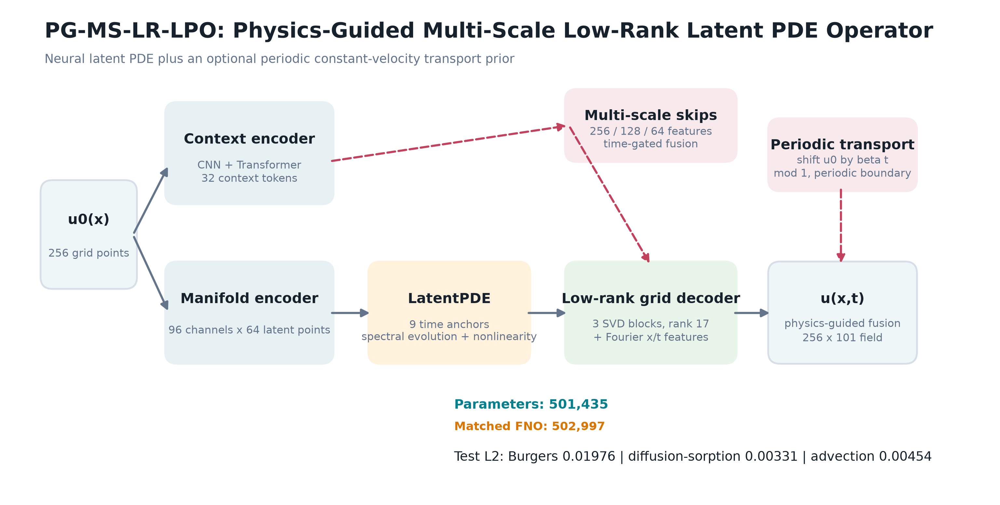
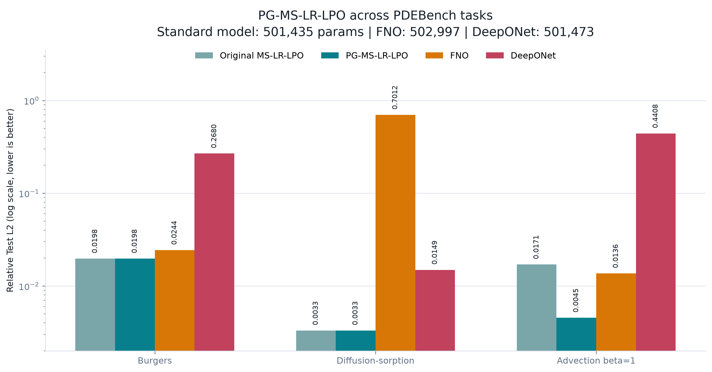
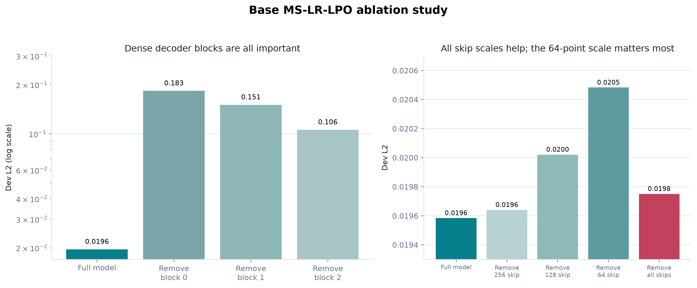
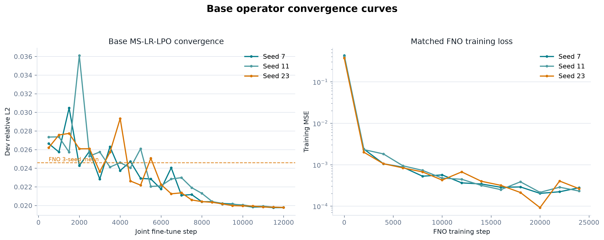

# 多尺度低秩潜空间 PDE 神经算子

**Multi-Scale Low-Rank Latent PDE Operator (MS-LR-LPO)**

用于学习一维 Burgers 方程解算子的神经算子项目。当前主线模型采用：

```text
u0(x) -> context encoder
      -> LatentPDE 时间演化
      -> 多尺度 skip connection
      -> 低秩二维网格解码器
      -> u(x, t)
```

目标方程：

```text
u_t + u u_x = nu u_xx
nu = 0.01 / pi
x in [0, 1), periodic
t in [0, 2]
grid: 256 x 101
```

## 项目图










## 当前结果

所有结果使用 PDEBench 官方 Burgers `Nu=0.01` 数据：

- 官方 HDF5 下载后按 `x[::4], t[::2]` 转为 `256 x 101`
- train: 官方样本 `1000:9000`，共 8000
- dev: 官方样本 `9000:10000`，共 1000
- test: 官方样本 `0:1000`，共 1000

### 501K 参数匹配对比

主模型将三个低秩解码块从 rank16 精确零扩展到 rank17，总参数为 `501,435`。新增通道在相邻投影层中的权重和偏置均为 0，因此零扩展前后的前向函数严格一致，三个 seed 的 Test L2 沿用同一组实测结果。

参数匹配基线：

```text
MS-LR-LPO: 3 low-rank blocks, rank 17        (501,435 params)
FNO:       width 104, modes 10, layers 4     (502,997 params)
DeepONet:  basis 128, branch 512, trunk 148  (501,473 params)
```

| 方法 | 参数 | Seed 7 | Seed 11 | Seed 23 | Mean +- Std |
|---|---:|---:|---:|---:|---:|
| MS-LR-LPO，rank17 零扩展 | 501,435 | 0.019759 | 0.019775 | 0.019767 | **0.019767 +- 0.000008** |
| 参数匹配 FNO | 502,997 | 0.024355 | 0.024388 | 0.025020 | **0.024588 +- 0.000375** |
| 参数匹配 DeepONet | 501,473 | 0.267974 | 0.261488 | 0.268660 | **0.266041 +- 0.003958** |

在相同官方 split 上，MS-LR-LPO 的 Test L2 比参数匹配 FNO 低约 `19.6%`，比 DeepONet 低约 `92.6%`。与 FNO 的三 seed Welch t 检验为 `p = 0.0020`。

DeepONet 每个训练步只随机采样 `256` 个时空点进行监督；MS-LR-LPO 和 FNO 使用完整 `256 x 101` 输出场。因此 DeepONet 数字反映当前标准配置，不应被解释为完全相同的监督条件。

补充的高监督对照把 seed 7 的随机点从 `256` 提高到 `4096`：Test L2 为 `0.250013`，比标准版改善约 `6.7%`，但仍比 501K MS-LR-LPO 的 `0.019759` 高约 `12.7` 倍，训练耗时也从 `57.6s` 增至 `582.1s`。监督点不足只能解释一部分差距。

### 参数口径

README 的主表统一使用 `501,435` 参数口径：

- rank16 原始 checkpoint 为 `498,555` 参数，是三 seed 精度实测来源。
- rank17 零扩展 checkpoint 为 `501,435` 参数；新增 `2,880` 个参数不参与有效计算，前向输出与 rank16 完全一致。
- 参数匹配 FNO 为 `502,997`，参数匹配 DeepONet 为 `501,473`。

### 物理残差

从 seed 7 数据模型继续加入归一化输出场 Burgers 残差：

```text
r = u_t + u u_x - nu u_xx
PDE relative = ||r|| / characteristic_scale
```

| 模型 | Test L2 | PDE Relative | 参数量 |
|---|---:|---:|---:|
| 501K 数据-only 模型 | 0.01976 | 0.4523 | 501,435 |
| 501K + PDE residual 微调 | 0.02038 | 0.3864 | 501,435 |
| 真值场参考 | - | 0.1469 | - |

物理微调使用周期中心差分计算 `u_x/u_xx`，避免谱导数在激波处产生过大的 Gibbs 残差。残差下降 `14.6%`，数据误差仍比 FNO 低约 `17.1%`。

### 零扩展说明

rank16 到 rank17 的新增通道初始化为零，数据-only 精度保持 `0.019764`。501K 的物理微调版本达到 Test L2 `0.020375`、PDE Relative `0.38635`。新增约 `2.9K` 参数没有改善数据精度，说明当前瓶颈已经不只是参数量。

## 关键结论

- FNO 不一定是必须的 backbone。LatentPDE + 多尺度 skip + 低秩网格解码可以在 `501K` 参数预算下取得比参数匹配 FNO 和 DeepONet 更低的 L2。
- decoder block 0 最重要，删除后误差会从约 `0.0196` 恶化到 `0.18`。
- 64 点粗尺度 skip 最重要，不能删除。
- 把 dense 3x3 块直接换成 depthwise 会严重掉点。
- 用 SVD 将 dense 块分解为低秩卷积，再从原模型恢复微调，能够保留大部分精度。
- 全分辨率 latent、联合重建和简单谱块没有稳定收益。
- 输出场 PDE 残差可以降低物理残差，但会牺牲少量 L2。

## 数据准备

官方 Burgers `Nu=0.01` 文件约 8.23 GB。当前实验只使用这个粘度，不需要下载全部 12 个粘度文件。

仓库提供并发范围和 MD5 校验下载器：

```bash
python datasets/download_parallel.py \
  --url https://hf-mirror.com/datasets/pdebench/Burgers/resolve/main/1D_Burgers_Sols_Nu0.01.hdf5 \
  --output datasets/pdebench_raw/1D_Burgers_Sols_Nu0.01.hdf5 \
  --md5 e6d9a4f62baf9a29121a816b919e2770 \
  --connections 32
```

转换为项目 parquet：

```bash
python datasets/pdebench_burgers_to_parquet.py \
  --input datasets/pdebench_raw/1D_Burgers_Sols_Nu0.01.hdf5 \
  --output-dir datasets/pdebench_burgers_official
```

默认划分：

```text
test  = 0:1000
train = 1000:9000
dev   = 9000:10000
```

## 训练

安装依赖：

```bash
pip install -r code/requirements.txt
pip install torch h5py
```

训练坐标解码基线：

```bash
python code/train_coord_attention.py \
  --data-dir datasets/pdebench_burgers_official \
  --train-samples 8000 \
  --steps 24000 \
  --batch-size 64 \
  --loss-mode full \
  --output-mode grid \
  --grid-hidden 48 \
  --grid-blocks 3 \
  --grid-length 64 \
  --dynamics latent_pde \
  --latent-channels 96 \
  --latent-length 64 \
  --pde-layers 1 \
  --pde-rank 24 \
  --pde-modes 32 \
  --rollout-steps 9 \
  --seed 7 \
  --save-model \
  --output-dir experiments/outputs_burgers_dataset/my_context_model
```

训练参数匹配 FNO：

```bash
python code/baselines_1d_burgers.py \
  --model fno \
  --data-dir datasets/pdebench_burgers_official \
  --train-samples 8000 \
  --dev-samples 1000 \
  --test-samples 1000 \
  --steps 24000 \
  --batch-size 64 \
  --width 104 \
  --modes 10 \
  --layers 4 \
  --seed 7 \
  --output-dir experiments/outputs_burgers_dataset/my_fno
```

训练参数匹配 DeepONet：

```bash
python code/baselines_1d_burgers.py \
  --model deeponet \
  --data-dir datasets/pdebench_burgers_official \
  --train-samples 8000 \
  --dev-samples 1000 \
  --test-samples 1000 \
  --steps 24000 \
  --batch-size 64 \
  --basis 128 \
  --branch-hidden 512 \
  --trunk-hidden 148 \
  --query-points 256 \
  --seed 7 \
  --output-dir experiments/outputs_burgers_dataset/my_deeponet
```

## 低秩压缩与恢复

关键脚本：

| 脚本 | 作用 |
|---|---|
| `code/finetune_all_lowrank.py` | 将三个 decoder block 做 rank16 SVD 低秩压缩并恢复微调 |
| `code/finetune_joint_lowrank.py` | 低秩模型全参数联合微调，支持 seed 和 checkpoint |
| `code/finetune_pde_residual.py` | 加入输出场 Burgers PDE residual |
| `code/expand_rank17.py` | 从 rank16 零扩展到 rank17，初始函数不变 |
| `code/run_joint_seed_queue.py` | 顺序运行 seed 11 / 23 |
| `code/run_fno_seed_queue.py` | 顺序运行参数匹配 FNO seed 11 / 23 |
| `code/run_deeponet_seed_queue.py` | 顺序运行参数匹配 DeepONet seed 7 / 11 / 23 |

运行三 seed 低秩联合微调：

```bash
python code/run_joint_seed_queue.py
```

运行物理残差微调：

```bash
python code/finetune_pde_residual.py
```

这些脚本默认读取：

```text
experiments/outputs_burgers_dataset/official_n8000/
```

实验输出、checkpoint、训练日志和大数据文件不会提交到 Git。

## 诊断脚本

| 脚本 | 作用 |
|---|---|
| `code/diagnose_pde_residual.py` | 比较真值与模型的 PDE residual |
| `code/diagnose_skip_from_best.py` | 恢复最优 checkpoint，训练 skip 分支并消融 decoder block |
| `code/diagnose_skip_scales.py` | 分别删除三个 skip 尺度，测量 dev/test 灵敏度 |

## 目录

| 路径 | 内容 |
|---|---|
| `code/coord_attention_operator.py` | LatentPDE、上下文编码、低秩网格解码和 skip |
| `code/train_coord_attention.py` | 坐标查询和全网格训练入口 |
| `code/baselines_1d_burgers.py` | FNO 与 DeepONet 基线 |
| `code/burgers_common.py` | 数据、网格和误差工具 |
| `datasets/download_parallel.py` | 大文件并发可恢复下载 |
| `datasets/pdebench_burgers_to_parquet.py` | 官方 HDF5 转项目 parquet |
| `datasets/find_pdebench_sample.py` | 在 HDF5 中定位 parquet 样本 |
| `analysis_plots_clean/make_current_figures.py` | 生成 README 中当前项目的 5 张图 |

## 已知限制

- 当前主结果基于单台 RTX 4060 Laptop GPU。
- 从已有最优 checkpoint 做低秩恢复约需 30 分钟，完整从零训练成本更高。
- 物理残差使用有限差分，在激波处仍然很大。
- 当前三 seed 验证复用同一低秩初始化，只是联合微调 seed 不同。
- 所有测试结果用于最终报告，模型选择使用独立 dev。

## 联系

zhengjiawei-abc  
1103493759@qq.com

最后更新：2026-11-22
